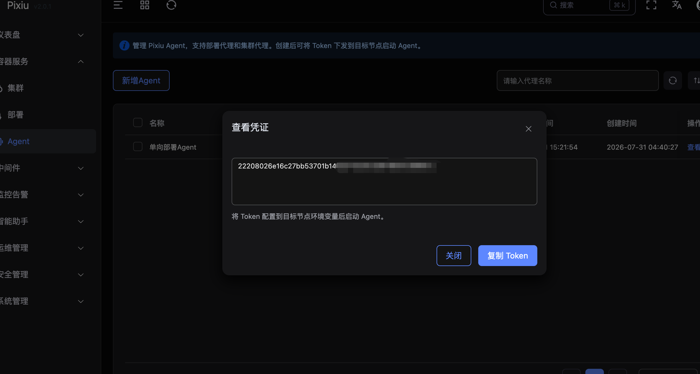

# Pixiu Deploy Agent

边缘节点主动出站连接 Pixiu，拉取部署任务与计划数据，在本地渲染配置并通过安装驱动容器完成集群部署。

## 工作原理

```
┌──────────────┐  HTTPS (出站)  ┌──────────────┐
│  Pixiu 控制面  │ ◄──────────── │  Deploy Agent │
│              │  拉取任务/回传   │  （边缘节点）   │
└──────────────┘                └──────┬───────┘
                                       │ socket
                                       ▼
                               ┌──────────────┐
                               │ 部署容器运行时  │
                               └──────────────┘
```

- 有任务时拉取执行，完成后回传结果
- 适用于单向网络环境（Agent 可访问控制面，反之不可）

## 前置条件

- Pixiu 控制面已部署，Agent 可访问控制面地址
- 已在控制面创建 Agent 并获取 Token
- Agent 节点已安装并运行 containerd（默认）或 docker

## 安装步骤
### 0. 容器运行时准备

- 基于 containerd：[离线安装](../../docs/offline-containerd.md) [在线安装](../../docs/online-containerd.md)
- 基于 docker：[Docker极速安装](../../docs/offline-docker.md)。

### 1. 获取 Token

在 Pixiu 管理页面「代理管理」中新增一个 **部署代理**，复制生成的 Token。


### 2. 下载二进制文件
[下载地址](https://github.com/offline-hub/repo/releases?page=2#release-deploy-agent)

```bash
# 赋予可执行权限
cp pixiu-deploy-agent-v2.0.1-amd64 /usr/local/bin/pixiu-deploy-agent
chmod +x /usr/local/bin/pixiu-deploy-agent
```

### 3. 生成配置文件

```bash
mkdir -p /etc/pixiu

cat > /etc/pixiu/agent.yaml <<EOF
default:
  server: "https://pixiu.example.com"
  token: "<your-agent-token>"
EOF
```

### 4. 注册 systemd 服务

```bash
# After/Wants 按宿主实际使用的运行时选：默认 containerd 用 containerd.service；
# 若在 agent.yaml 里配了 cri: docker，则把下面两行的 containerd.service 换成 docker.service
cat > /etc/systemd/system/pixiu-deploy-agent.service <<EOF
[Unit]
Description=Pixiu Deploy Agent
After=network.target containerd.service
Wants=containerd.service

[Service]
Type=simple
ExecStart=/usr/local/bin/pixiu-deploy-agent -config=/etc/pixiu/agent.yaml
Restart=always
RestartSec=5
LimitNOFILE=65536

[Install]
WantedBy=multi-user.target
EOF

systemctl daemon-reload
systemctl enable pixiu-deploy-agent
systemctl start pixiu-deploy-agent
```

### 5. 验证状态

```bash
systemctl status pixiu-deploy-agent
journalctl -u pixiu-deploy-agent -f
```

正常日志应显示 `pixiu-deploy-agent v0.1.0 starting, server=https://pixiu.example.com`，且心跳日志定期出现。

## 远端 Shell（可选）

Agent 默认开启远端 Shell：在本地 `unix` socket 上提供 PTY 服务，服务端通过反向隧道（`/pixiu/connect`）按需接入，管理员可在控制台直接登录该节点执行命令。Shell 启动失败（如目录无权限）时仅记录错误日志并禁用该能力，不影响作业轮询与部署功能。

默认值：

| 配置项 | 默认值 | 说明 |
|--------|--------|------|
| `enabled` | `true` | 关闭后不监听 socket、不建立 Shell 隧道（部署隧道不受影响） |
| `command` | 自动探测 | 优先 `/bin/bash`，不存在时回退 `/bin/sh` |

本地 socket 路径固定为 `/run/pixiu/deploy-agent/shell.sock`（所在目录 `0700`、socket `0600`），不提供配置项：服务端始终按该路径拨号，改动路径将导致登录不可用。

配置示例：

```yaml
default:
  server: "https://pixiu.example.com"
  token: "<your-agent-token>"
  shell:
    enabled: true
    command: /bin/bash
```

安全说明：

- Shell 以 **agent 进程的运行用户** 身份执行（systemd 默认 root）。仅 Pixiu 控制台中的 root/管理员可发起登录，链路复用 Agent Token 的反向隧道。
- socket 路径固定为 `/run/pixiu/deploy-agent/shell.sock`，目录权限 `0700`、socket 权限 `0600`，防止本机普通用户直接连接获得高权限 Shell。
- 建议收紧配置文件权限：`chmod 600 /etc/pixiu/agent.yaml`（文件内含 Agent Token）。
- 如需完全禁用，将 `shell.enabled` 设为 `false`。

运行环境差异：

- 裸机 / systemd 直接运行 agent 时，Shell 进入的是 **宿主机** 环境。
- 以容器方式运行 agent 时，Shell 默认进入 **agent 容器内部**；若需要操作宿主机，需在容器启动时共享宿主命名空间或挂载宿主根目录（按部署实际情况评估安全影响）。
